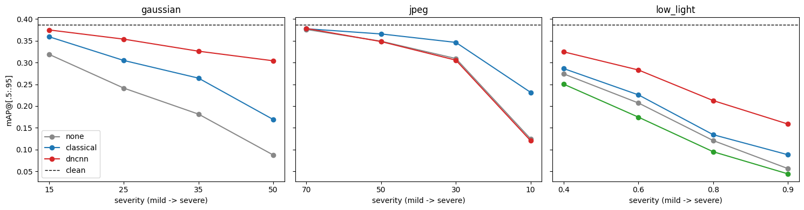
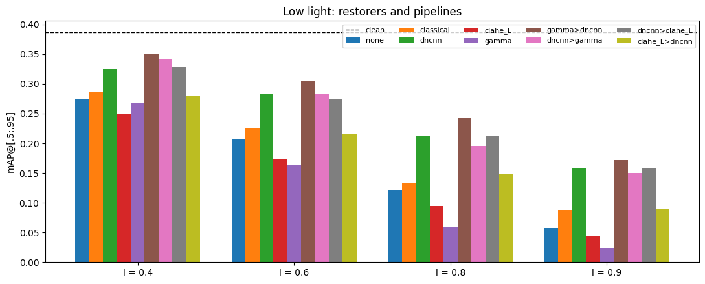

# Degrade → Restore → Detect

**Does repairing a damaged image help a computer find the objects in it, or does it only make the picture look better?**

📄 **Paper:** [`paper/paper.pdf`](paper/paper.pdf) (arXiv-style, 16 pages, LaTeX source in [`paper/`](paper))
📘 **Study guide:** [`docs/notebook_explainers.pdf`](docs/notebook_explainers.pdf) (every notebook explained, function by function)
📑 **Long technical report:** [`report/report.pdf`](report/report.pdf) (all experiments in detail, with a plain-language summary)

---

## The question

Image restoration methods (denoisers, deblockers, contrast enhancement) are almost always graded by **PSNR**: how close the repaired image is to the original, pixel by pixel. More and more, though, repaired images are read by machines, not people. This project tests whether restoration actually helps a pretrained object detector, and whether PSNR predicts which restorer helps most.

| Step | What happens |
|---|---|
| **Degrade** | Clean photos are damaged with seven seeded models (Gaussian, Poisson and salt-and-pepper noise, blur, JPEG, colour cast, low light) at five strengths. Every restorer sees the identical damaged image. |
| **Restore** | Tuned classical filters, BM3D, colour-space denoising, HE/CLAHE, gray-world, Wiener deconvolution, a **blind DnCNN trained from scratch**, and brighten-and-denoise pipelines. |
| **Detect** | YOLOv8n scored with COCO mAP@[.5:.95] on 300 COCO val2017 images (2,035 objects), with paired bootstrap confidence intervals. |

## Key findings

| Damage | What helps detection | Is PSNR a good guide? |
|---|---|---|
| **Gaussian noise** | A strong denoiser recovers about three-quarters of the lost mAP: **DnCNN 70–83%**, **BM3D 70–76%**, tuned simple filters 27–60%. DnCNN leads BM3D by 0.6–1.8 dB PSNR, but their detection results are statistically tied. | Yes, between methods |
| **JPEG** | Only at strong compression: the bilateral filter recovers 41–48% at q = 30 and 10. DnCNN (never trained on JPEG) never helps. | Ranking yes, size no |
| **Low light** | **Brighten, then denoise** (gamma → DnCNN) is best at every level, recovering 35–67%. CLAHE and brightening alone *raise* PSNR but *lower* mAP, because they amplify noise. | **No** |



- **Most differences are real.** A paired bootstrap (10,000 resamples of the 300 images) shows them as statistically clear; see the forest plot in [`figures/fig24_bootstrap_ci.png`](figures/fig24_bootstrap_ci.png).
- **PSNR says almost nothing about individual images.** A restorer's PSNR gain on an image barely predicts its detection gain on that image (Spearman −0.14 to +0.21).
- **Object size:** noise and darkness hurt small objects most; heavy JPEG hurts large objects most.
- **Inside the network:** DnCNN learned colour-opponent first-layer filters, widens its effective receptive field as noise grows, and keeps up to 1.9× more spatial frequency than the best classical filter. On damage it never saw (JPEG, blur) it produces streaks along strong edges.



## Built from scratch and verified

| Component | Check | Result |
|---|---|---|
| JPEG codec (DCT, quantisation, zigzag, run-length entropy) in NumPy | PSNR against libjpeg at equal quality | within 0.05 dB up to q = 90 |
| Convolution layer, forward and backward, in NumPy | against numerical gradients | relative error ≤ 7e-10 |
| Blind DnCNN (17 layers, 558k parameters) | against the published model on CBSD68 | within 0.2 dB (33.76 / 31.05 / 27.69 dB at σ = 15 / 25 / 50) |
| Degradation models | statistical tests (noise std, Poisson variance, …) | all 9 pass |

## Repository layout

```
paper/
  paper.pdf                 the paper (arXiv-style)
  main.tex, refs.bib        LaTeX source; figures/ holds the images it uses
notebooks/
  01_degradations_and_baselines.ipynb   damage models, PSNR/SSIM, classical filters, colour spaces, HE/CLAHE, Wiener
  02_jpeg_from_scratch.ipynb            JPEG codec in NumPy, rate-distortion against OpenCV
  03_numpy_conv_gradcheck.ipynb         conv layer forward/backward, gradient checks, im2col
  04_dncnn_training.ipynb               blind DnCNN training and evaluation (Kaggle GPU)
  05_detection_eval.ipynb               YOLOv8n mAP under damage and restoration (Kaggle GPU)
  05b_quick_wins.ipynb                  follow-up: bootstrap CIs, AP by object size, BM3D, low-light pipelines
  06_denoiser_analysis.ipynb            filters, receptive field, frequency response, failure gallery
degradations.py      damage functions shared by the notebooks (written by notebook 01)
scripts/bootstrap_ci.py   paired bootstrap confidence intervals from per-image AP
results/             tuned filter settings, PSNR tables, DnCNN checkpoint, detection sweeps, CI tables
figures/             all report and paper figures
docs/                notebook explainers (study guide)
report/              long technical report
```

All notebooks are saved with their outputs, so every number can be checked without re-running.

## Running it

```bash
pip install -r requirements.txt
```

- **Notebooks 01–03** run on a laptop CPU. Notebook 01 needs BSD500 (on Kaggle: *Berkeley Segmentation Dataset 500*, balraj98).
- **Notebooks 04–06 and 05b** need a GPU; they were run on Kaggle (T4). Notebooks 05 and 05b download COCO val2017 and YOLOv8n, and load `results/04/dncnn_last.pt` and `results/01/best_classical.json`. Notebook 05b takes about 8 hours, mostly BM3D on the CPU; set `QUICK = True` for a 10-minute check.
- To rebuild the paper: `cd paper && latexmk -pdf main.tex`.

## Reproducibility

All randomness is seeded, and each damaged image is seeded by its (image, degradation, severity) indices, so every method is compared on the identical input. The 100 BSD500 validation images are split into 4 tuning and 96 test images; DnCNN trains on the 400 train and test images with no overlap (checked by file name and pixel hash). Detection uses a fixed 300-image COCO subset; notebook 05b reproduces notebook 05's 40 shared runs exactly.

## Limitations

One detector and 300 images; synthetic damage; DnCNN trained only on Gaussian noise; tuned filters and BM3D given the true severity (which favours them). Details are in Section 6 of the paper.

## Citation

```bibtex
@misc{banerjee2026degrade,
  author = {Banerjee, Shourja},
  title  = {Does Restoration Help Detection? A Controlled Study of Denoising, Deblocking and Low-Light Enhancement for Object Detection},
  year   = {2026},
  howpublished = {\url{https://github.com/onigiri4711/degrade-restore-detect}}
}
```

## Key references

- K. Zhang et al., *Beyond a Gaussian Denoiser: Residual Learning of Deep CNN for Image Denoising* (DnCNN), IEEE TIP 2017.
- K. Dabov et al., *Image Denoising by Sparse 3-D Transform-Domain Collaborative Filtering* (BM3D), IEEE TIP 2007.
- D. Liu et al., *When Image Denoising Meets High-Level Vision Tasks*, IJCAI 2018.
- T.-Y. Lin et al., *Microsoft COCO: Common Objects in Context*, ECCV 2014; Ultralytics YOLOv8, 2023.

The full bibliography is in [`paper/refs.bib`](paper/refs.bib).
